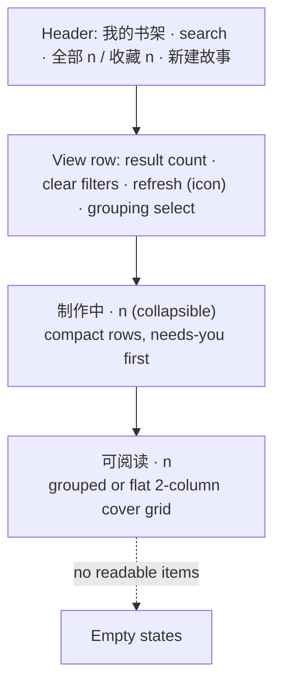

# Shelf (书架) redesign

Requirement: [req-shelf-redesign.md](../../../../reqs/2026/11/05/req-shelf-redesign.md)

Git base: `4e72614`. Branch `main`. Clean worktree at entry.

Risk: medium. This is UI only, with no API, model or storage change. But `ReaderShelf.tsx` is covered by three render tests that pin labels and handler wiring, and the shelf styles are spread across `reader.css` as layered overrides (`.yu-shelf-card` appears in 26 rules, `.yu-shelf-grid-single` in 23).

## Design

### Layout

- **Regions.** Partition the visible items (after the tab filter and search) once:
  - `production`: items with no `story`, which are today's `pending` sessions without a first-page image.
  - `readable`: items with a `story`, including covered stories whose generation is incomplete.
  - Grouping applies only to `readable`. The production region is never grouped. Its order is a priority, so grouping it would only add more headers.
  - **Why covered incomplete stories stay readable:** they can already be opened and read up to the generated frames. Moving them would remove the cover reading path, and the cover-actions test pins that path (`打开《》`, `阅读《》`, `继续阅读《》` on a failed covered story).
- **Production rows** (`yu-production-row`), one line each at about 64px:
  - The whole row is the `yu-pending-story` button (the class name is pinned by `story-title-ui.test.mjs`). It shows `<strong>` title, a meta line `book · theme · style` with the revision marker, and a status pill coloured by tone: needs-you = amber, failed = red, running/queued = green, paused = grey.
  - Its label stays `generation.action + 《title》`, and clicking it still calls `onResume(session)`.
  - To the right sits one inline control, chosen by the existing rules: `重试生成` (failed + retryAllowed) or `StoryGenerationControl` (pause/resume). It is not shown for intake states, where the row button is the action. `继续生成` for the auto-paused retry case stays as is.
  - Favorite and delete sit in a compact trailing icon pair with the same labels and disabled rules.
  - `generation.detail` moves into a visually hidden span inside the row button, so screen readers still announce it. For `生成失败`, the session error stays visible as one clamped line, because it is specific information.
- **Priority** (pure helper in `lib/shelf-generation.ts`): `shelfProductionPriority(group)` puts the needs-you statuses first (`待提取故事`, `待选故事`, `待制作确认`, `待选画幅数`, `生成失败`), then `生成中`, `等待生成`, `生成已暂停`. Sorting is stable, so the existing order is kept within a status.
- **Collapse.** The region is a `
` reusing the `ShelfGroup` persistence, with key `shiqu-shelf-group:production`. It is open by default. The summary shows `制作中`, the count, and a `n 项待处理` pill when needs-you items exist, so they stay visible even when collapsed.
- **Row limit.** Show every needs-you row, then fill up to 5 rows in total with the rest. If rows are hidden, a `显示全部 n 项` / `收起` toggle appears; this state is not persisted. While the search box is non-empty, all matching rows show.
- **Live updates.** Session polling can move a row to another priority bucket. The order within a bucket is stable, so the only movement is a row moving between buckets, which matches the status change the user can see. Nothing else reorders.
- **Readable cards:**
  - Remove the full-width single-story variant (`fullWidth` / `yu-shelf-grid-single` / `yu-shelf-row-compact`), so every grid is 2 columns of equal cards.
  - The cover keeps the overlay (book badge, favorite, delete). Incomplete generation is shown once, by the existing status line and control in the card body; a second chip on the cover was dropped as redundant.
  - Below the cover: title (2-line clamp), tags (1 line), a thin reading progress bar, and the footer `第 n / m 幅 · 接着看`. When `page+1 >= pages.length` the footer reads `已读完 · 重读`, while the button keeps the label `继续阅读《》`.
  - `feedback` (status + control) stays on the card body for incomplete stories.
- **Default grouping:** without a saved preference, the shelf opens `不分组`, so readable stories form one flat grid in shelf order.
- **Header and controls:**
  - Drop the kicker line and keep `h1` with the search box.
  - Tabs show counts (`全部 54`, `收藏 1`), with `新建故事` on the right.
  - The view row keeps the result/filter status and the grouping select; refresh becomes an icon button with its existing label `刷新书架`.
  - Group summaries become a slimmer sticky-free header row.
- **Empty states:** unchanged copy. Add one case: when `readable` is empty but `production` is not, show a one-line hint under the production region (`还没有可阅读的故事，完成制作后会出现在这里。`).
- **Styles:**
  - Move every `.yu-shelf*` / `.yu-pending*` rule out of `reader.css` into a new `client/ui/ReaderShelf.css`, imported by the component and rewritten without the layered overrides.
  - `reader.css` lines are dense one-line rule sets, and some shelf rules sit inside shared `@media` blocks. Use a script that parses rule sets, removes only the rules whose selectors are all shelf selectors, and splits mixed selector lists. Then check that the non-shelf rules are byte-identical (compare the rule lists before and after).
  - Only `ReaderShelf.tsx` uses these classes. `desktop/resources/runtime` is build output; the desktop reader picks up the change on its next build, which is not run here.
- **Unchanged:**
  - The `ReaderShelf` props, `Reader.tsx` wiring, and the `我的` counts.
  - `lib/shelf-browser.ts` exports, which the desktop `LibraryPane` uses; they stay compatible.
  - `localStorage` keys, server APIs, and the CLI/skill.

## Tasks

- [x] Add `shelfProductionPriority` (and export the needs-you set) to `lib/shelf-generation.ts`, with unit tests for order and stability.
- [x] Change the `Reader.tsx` grouping fallback from `book` to `none`.
- [x] Restructure `ReaderShelf.tsx`: partition into production/readable; render the production `
` with compact rows; render readable groups/grid without the full-width variant; finished-reading footer; header counts on tabs; empty hint for production-only shelves. Update the file comment block in Chinese.
- [x] Create `client/ui/ReaderShelf.css`; remove the shelf rules from `reader.css` and check that the remaining rules are unchanged.
- [x] Update the render tests where the markup intentionally changed (keep every pinned label and handler assertion), and add tests for:
  - production rows rendering before readable cards with one primary control;
  - needs-you ordering;
  - the `已读完` footer;
  - equal-size cards for single-story groups;
  - the production-only empty hint;
  - search and the 收藏 tab filtering both regions.
- [x] Verify in the in-app browser against the running `pnpm dev` at 375px and desktop width: page height, no horizontal scroll, collapse persistence, search/tab/grouping. Do not click pause/resume/retry/delete or anything else that changes the real library; use the render tests for those paths.
- [x] Typecheck, lint, and full `pnpm test` (under Node 24 where available; note environment-only failures with base comparison).

AR passed: no blocking architecture flaws

AR risk: medium — UI-only, but pinned render tests and the dense `reader.css` style migration need care.

AR review round: 1; reviewer: self

Applied AR notes:
- Covered incomplete stories stay in the readable grid, which keeps the cover reading path and the pinned cover-action test.
- The production region limits rows (needs-you always visible; search shows all) so 11 paused items do not bury the readable stories.
- Rows move only between priority buckets on live status changes.
- The `reader.css` migration uses a parsed, rule-level removal with a byte-identical check of the non-shelf rules, including shared `@media` blocks.
- Failed rows keep the specific error visible; generic explanations become screen-reader text.
- Test constraints were checked: `yu-pending-story` class, `《title》` labels, a single `重试生成`, and no `暂停生成` / `恢复生成` on failed rows. The hidden paused explanation contains `恢复生成`, which the paused test expects anyway.

User decision (2026-11-05): approved; when no grouping preference is saved, the default becomes `不分组` (`Reader.tsx` fallback). A saved preference is still honoured.

Implementation notes:
- Production rows show one control. A system-paused job that can be retried shows only `继续生成`; the old card also showed `暂停生成`. Needs-you rows show no pause button; the row button is the action.
- The revision marker reads `第 n 版`. Tags are one dot-separated line that only truncates at the end. Cover images load lazily.
- `reader.css`: 169 rules moved out (shelf selectors plus the shelf-only `.yu-delete-story`) with a parsed, rule-level script. The other 664 rules were checked identical, and 9 orphaned comments were removed.
- `tests/shelf-art-style.test.mjs` now asserts that unfinished items keep their art-style tag without a group header. New `tests/shelf-layout-ui.test.mjs` covers ordering, single controls, the visible error, the row limit, search, equal cards, `已读完`, filters and empty states. `tests/shelf-generation.test.mjs` covers priority sorting.

CR passed: no high-priority findings

CR review round: 1; reviewer: self

CR repairs: scoped the shelf's `white-space:nowrap` to `.yu-shelf .yu-generation-control` so story-page controls are unchanged; added a space before the tab counts so they are announced as "全部故事 54".

Verification: Node 24.22.1. Typecheck and lint pass. Full `pnpm test`: 1,324 tests, all pass. After the CR repairs, the shelf suites pass 23/23. In-app browser against the running `pnpm dev` library (54 items):
- At 375px, page height went from about 11,400px to about 8,000px, with no horizontal scroll at 375px or 1100px.
- The production region shows 5 of 11 rows (2 needs-you first); "显示全部" and "收起" both work.
- Book grouping renders single-story groups as half-width cards.
- Search and 收藏 filter both regions, and lazy covers load.
- No pause, resume, retry, favorite or delete action was clicked against the real library.
