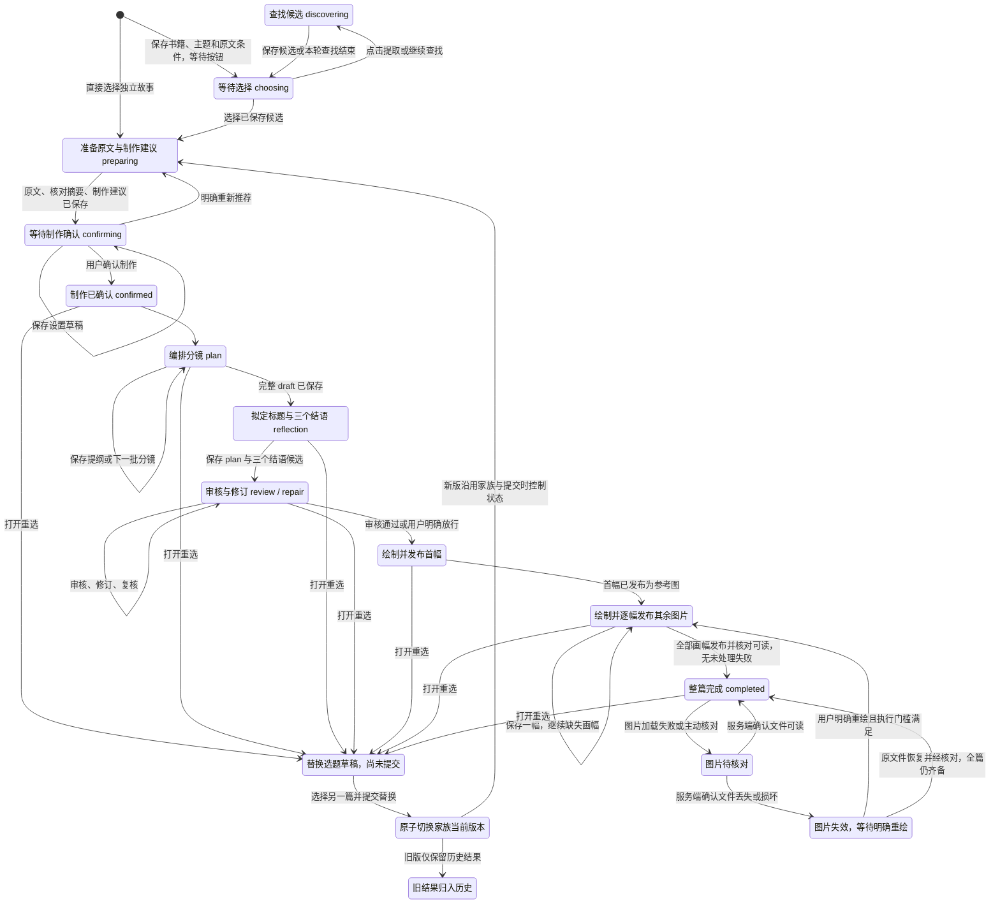
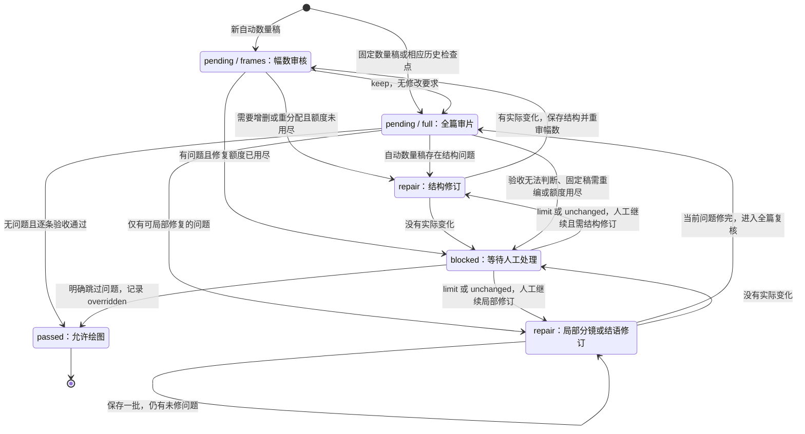
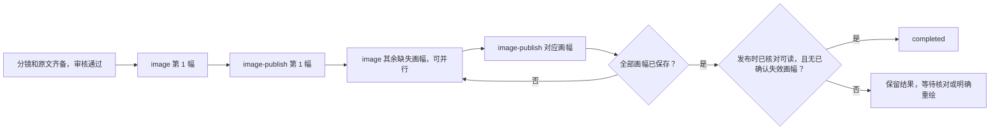
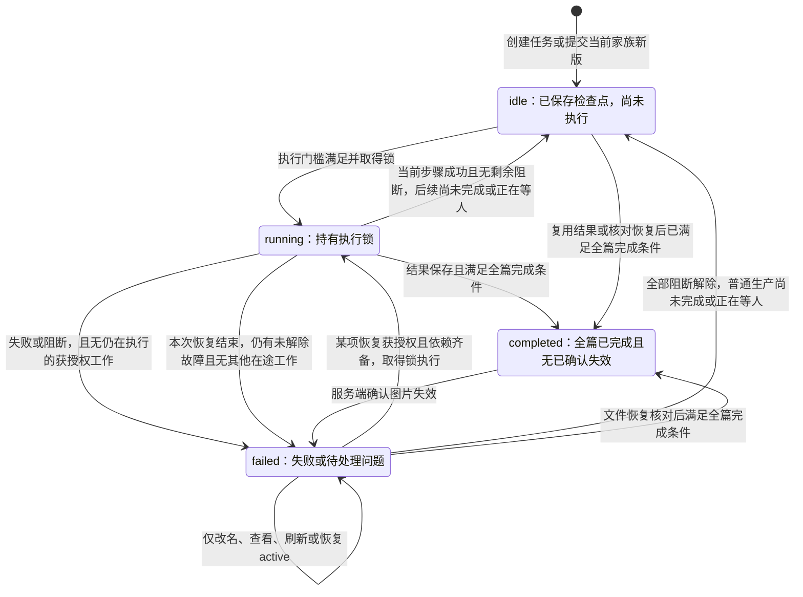
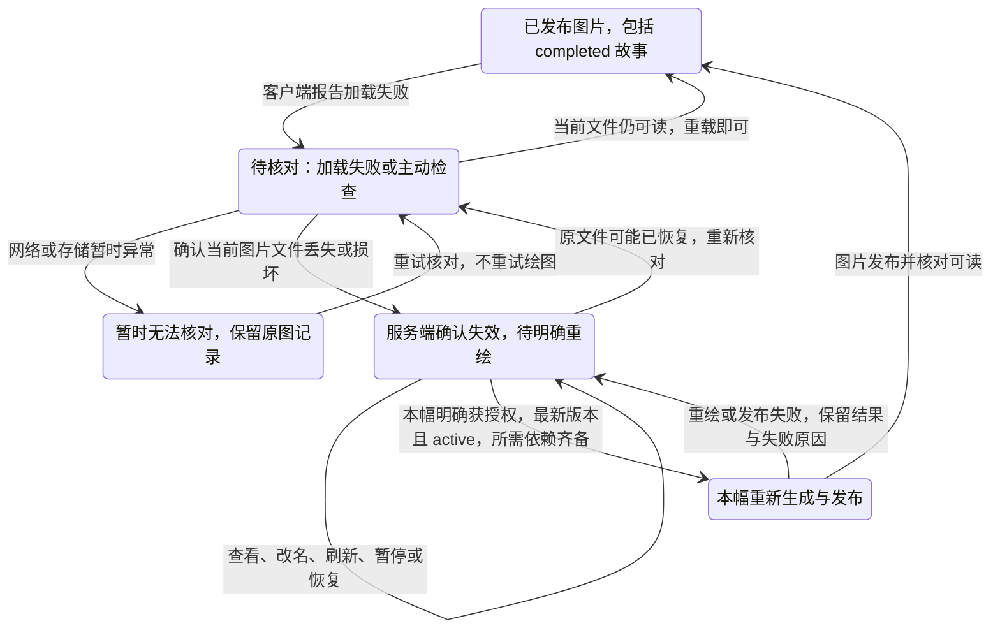
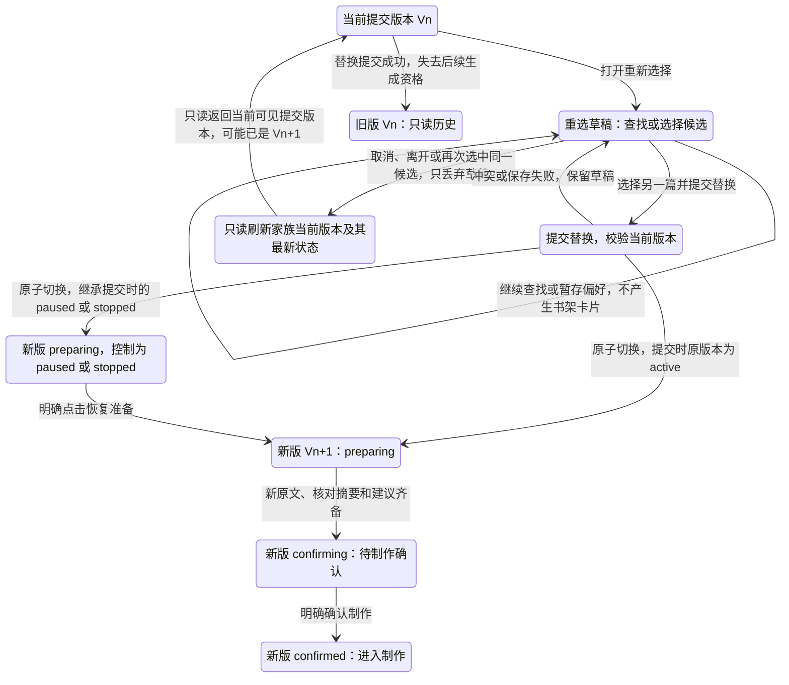

# 故事生成状态机

本文定义故事生成的生产状态机：从创建意图、选择故事、确认制作，到分镜、审核、绘图和整篇完成，并覆盖替换选题、失败恢复和历史版本隔离。本轮按已审规格更新正式 API、持久队列和阅读界面；验证记录见[验收规格](tests/test-story-generation-state-machine.md)。

| 原问题 | 生产行为 |
| --- | --- |
| 重选立即多一本书 | 重选草稿不上书架，选择另一篇才切换同一家族当前版；旧结果保留历史 |
| 改名改变任务身份，可能多付一次 | 显示名与生成输入分离，改名不生成、不重试；升级迁移保留已有任务和付费回执 |
| 有图片地址就永远完成 | 服务端确认文件失效后撤销完成，按幅等待授权；恢复文件只核对复用 |

业务节点不等同于数据库枚举。`reader_faults` 独立保留故障，`reader_commands` 保存一次授权的回执；整份 Document 的迟到保存不能清除故障。

[开发指南](development.md) · [创建、编辑与队列概览](story-creation-editing-queue.md)

## 1. 核心模型：保存检查点，再决定下一步

故事生成不是一个不断自增的进度枚举。每次执行先判断版本、用户控制、失败及确认门槛是否允许工作，再从已保存的 `Document` 推导 `nextStep()`；完成后保存检查点，再决定下一步。**有下一步不等于获准执行下一步。** 失败恢复主要依靠已保存结果，而不是把整条流程重跑。

状态分成几个维度，必须一起看：

| 维度 | 字段与取值 | 回答的问题 |
| --- | --- | --- |
| 创建与确认 | `intake.phase`：`discovering / choosing / preparing / confirming / confirmed` | 是否已经选定故事、授权制作？ |
| 会话执行 | 数据库 `state`：`idle / running / failed / completed` | 当前会话是否被工作器执行，或已失败、完成？ |
| 下一步 | `generationProgress.phase`：如 `recommend / plan / reflection / review / repair / image` | 已保存结果还缺什么？ |
| 审核检查点 | `visualReview.status`：`pending / repair / passed / blocked`；`phase`：`frames / full` | 正在审核什么，能否开始绘图？ |
| 用户控制 | `generationControl`：`active / paused / stopped` | 是否允许启动后续生成任务？ |
| 调度方式 | `generationMode`：`background / reader` | 整篇后台生成，还是依赖阅读需求？ |
| 队列执行 | 任务 `state`：`queued / running / succeeded / failed` | 某次具体工作是否取得执行资格、完成并保存回执？ |
| 界面投影 | `productionState`：`running / queued / paused` | 此刻队列实际在做、在等，还是没有可运行工作？ |
| 图片可用性 | 已核对可读、待核对、确认失效；与会话状态分开记录 | 已保存地址对应的文件是否仍然可读，是否获准重绘？ |

**不要把 `idle` 当成暂停，也不要把 `running` 当成当前业务步骤。** `idle` 经常只是一个检查点已经保存、等待下一个任务；接口快照还会结合队列，把持久化的会话状态投影成前端状态。

故事家族标识代表**同一张书架卡片**，版本标识代表某次已提交的制作内容。替换选题和修改制作内容可以产生新版本，但不产生第二张卡片；只有独立的“新建故事”动作建立新家族。

## 2. 主流程

图中“原文、分镜、绘图”等节点是业务阶段，不是额外新增的数据库状态。

“替换选题草稿”和“图片待核对”是叠加在当前制作状态上的业务节点：取消重选只丢弃草稿，重新读取家族当前提交版本及其最新状态，不能回滚到打开窗口时的快照；暂时无法读取文件时保留待核对，不推断文件已经丢失。替换过程见第 7 节，图片核对见第 6 节。`completed` 是可重新核对的完成检查点，不是永远不可离开的终态。

普通制作修订可以复用有效图片，直接进入缺失画幅的绘制或完成判定。**替换为另一选题不能复用旧故事的原文、分镜和图片作为新故事结果。** 通用失败和暂停逻辑见后文。

新建未选定故事与重选草稿均从 `choosing + search.idle + round 0 + 空 batches` 开始。打开、轮询、观看需求和服务重启不授权提取。标题方式切换和输入只是本地草稿；点击“开始提取”或“按标题提取”才提交 `search`，保留主题和原文范围并建立新轮次。已经开始的搜索继续沿用原有连续发现逻辑，直接选择 `source` 仍进入准备。

### 创建阶段的转换条件

| 当前阶段 | 事件或条件 | 下一阶段与副作用 |
| --- | --- | --- |
| 未选定的 `choosing` | 明确 `search` | `discovering`；保存标题条件、重置候选并增加 generation/round；重放沿用回执 |
| `discovering` | 候选逐项保存；本轮查找收束 | 可进入 `choosing`；搜索另有独立状态，已有候选不必等搜索全部结束才选择 |
| `choosing` | `choose` | `preparing`；绑定候选，清除旧原文和建议，停止当前搜索，递增 `intake.generation` |
| 未确认制作 | `more` | 新一轮搜索；没有已选故事时进入 `discovering`，已有选择时保留当前准备阶段 |
| `preparing` | `recommend` 步骤成功 | `confirming`；保存原文、核对为 `verified` 的完整摘要、制作建议；必要时准备画风推荐 |
| `preparing / confirming` | `draft` | 原阶段；只保存制作设置草稿，不启动分镜 |
| `confirming` | `recommend` 动作 | `preparing`；删除旧建议，重新准备 |
| `confirming` | `confirm`，原文、建议和所需核对摘要齐备 | `confirmed`；设置 `frameCountConfirmed=true`，切到 `background + active`，允许生产 |
| `confirmed` 及其后的制作阶段 | 修改制作内容 | 提交同一家族的修订版本，原版本保留历史 |
| `confirmed` 及其后的制作阶段，包括完成、暂停或失败 | 重选另一篇并提交替换 | 同一家族原子切换到新版 `preparing`，继承提交时的控制状态；暂停或停止时等待“恢复准备”，不跳过新选题的制作确认 |

搜索另有 `intake.search.state = idle / searching / failed`，不能与 `intake.phase` 混为一谈。搜索失败保留候选，并不等于整篇生产失败。查找任务需要有效的查看者需求；单有后台制作意图不会让关闭后的选择页一直找故事。选中后用搜索轮次与选择代次隔离迟到结果。

## 3. 下一步如何决定

生产调度器将分镜工作拆成检查点任务，实际执行共同调用 `advanceStory()` 和 `nextStep()`。下表列出已有步骤推导顺序；实现须在付费调用前再次校验以下执行门槛：

1. 当前用户可访问该任务，版本仍是家族的最新提交版本；被删除或替代的版本不能领取新生成工作。
2. `generationControl=active`，且存在适用的后台或查看者需求。
3. 普通生产遇到尚未处理的普通失败、审核阻断或图片失效时，不继续新增模型调用；**已获明确授权的恢复任务按其目标与依赖独立判断**，不要求整篇先清空所有故障。`resume`、改名、查看、刷新和修改优先级都不能清除故障或授予恢复权限。
4. `plan / reflection / review / repair / image` 只允许在制作已确认后启动；准备和搜索按各自阶段执行。旧任务沿用已有确认兼容规则。
5. 绘图必须已有原文、完整计划，且审核通过或被用户明确放行；非首幅还须有可用参考图。
6. 任务输入版本、选择代次和租约仍有效；显式重试也不能复活旧版或使用过期输入。

显式“重试”“继续自动修复”“跳过问题并绘图”“重绘第 N 幅”只授权处理各自对应的故障范围，不能顺带解除暂停、旧版隔离或制作确认门槛。已开始的工作保存结果和本地发布收尾使用独立规则，不因暂停就丢弃结果。

### 故障与恢复按任务范围隔离

每项故障需要保留其所属版本、步骤或画幅、失败类型、对应输入身份和**不可复用的故障实例标识**。同一步骤再次发生普通失败时产生新故障实例，不能覆盖原实例或沿用其恢复授权。恢复授权绑定同样的范围；不以清空全局 `error` 或提前删除失效标记来换取执行资格。

| 工作类型 | 允许执行的条件 | 其他故障如何处理 |
| --- | --- | --- |
| 普通后续生成 | 正常执行门槛满足，当前生产没有待处理的阻断故障 | 等待故障恢复，不因某个恢复请求自动重启所有后续工作 |
| 显式重试某个失败步骤 | 该故障的适用恢复动作已获授权，所需上游结果可用，版本、控制与租约有效 | 无依赖关系的故障不阻止本次恢复，也不被此次请求清除 |
| 明确重绘第 N 幅 | 第 N 幅已确认失效且获授权；原文、分镜、审核及所需参考图满足条件 | 其他非依赖画幅仍失效时，也允许恢复第 N 幅；保留其他失效标记 |
| 重试保存第 N 幅 | 第 N 幅已生成结果可读，获相应发布重试授权；满足当前图片输入及发布锁要求 | 另一幅丢失不阻止本地发布；不重新调用模型。本地在途发布仍可按收尾规则完成 |
| 原文件恢复后的核对 | 核对当前图片身份与实际像素可读性，只读文件，不调用模型 | 只解除该图片的失效；其他失败或失效仍保留 |

恢复任务可以处理**自身负责的故障**，并忽略无依赖关系的其他故障，但不能跳过坏掉的上游。例如，第 2、3 幅同时丢失时，可以只重绘第 2 幅；首幅参考仍失效时，第 2 幅则必须等待首幅恢复。这个等待不能靠对第 2 幅重复点击重绘绕过。

恢复进行中保留故障记录，注明该范围正在处理；对应结果保存并核对成功后才解除故障。局部成功后仍有故障时，故事不能进入 `completed`，其他恢复入口仍应可用；只有全部阻断故障解除后，才允许原有制作授权下的普通生产继续。单次恢复不得顺带重试其他失败任务，恢复再次失败仍按其类型等待适用动作或符合条件的中断恢复。

### 用户命令的幂等与恢复授权

会创建版本、启动或恢复制作、改变用户控制、重试失败或重绘图片的用户命令，必须使用稳定的请求标识。前端按钮禁用只能减少重复点击，不能代替服务端持久化幂等；请求身份必须在发送前确定，响应丢失后沿用原身份，不得自动生成新身份再试。

| 命令要素 | 必须保证的规则 |
| --- | --- |
| 请求身份 | 按用户隔离，绑定动作、目标家族与版本、相关输入身份和参数指纹；同一标识配不同参数必须拒绝 |
| 恢复目标 | 重试准备、重试生成、继续自动修复、重试保存图片和重绘都绑定明确的故障实例；不允许把“重试当前失败”当作可作用于后来任意失败的命令 |
| 首次受理 | 原子校验故障仍适用、执行前提满足且没有被另一命令领取，再保存命令回执及本次恢复工作；受理与入队必须可原子完成或从回执幂等补齐，不能保存回执后永久漏排任务 |
| 处理中的同一故障 | 相同命令返回已有受理结果；另一个请求标识也不能同时领取同一故障，返回“正在处理”及已有工作状态，不再排队或重置额度 |
| 已受理命令重放 | 只读返回该命令的受理结果与对应工作当前状态；不重新应用控制、不再次建版、不再次排队、不重置尝试额度，不把旧授权转到新故障 |
| 恢复再次失败 | 保留原命令及结果，建立新的普通失败实例；原故障实例标为被新实例接替，不再作为独立待处理故障，后续恢复授权只能针对新实例。图片失效标记仍保留至恢复成功，其他范围的故障不变。受控的中断恢复仍归原命令，共用其最多 3 次尝试额度，不因请求重放扩充额度 |
| 目标已变化 | 新命令若依据旧故障、旧版本或旧输入，拒绝并保留当前状态；已受理命令的重放不重新执行。所有回执读取仍检查权限与删除状态，不能借幂等查询绕过访问限制 |

例如，重试请求 R 已受理但响应丢失，该次调用随后普通失败：重放 R 只能读到 R 的失败结果，不能再让任务从 `failed` 进入 `queued`。用户看到新的失败后明确点击重试，才针对新故障发送 R2。即使 R 在 R2 开始、暂停或失败后迟到，也不能改变 R2 的状态、控制或额度。“继续自动修复”的新一段修复额度也只能由一条新的有效授权建立一次。

| 优先级 | 已保存条件 | 下一步 |
| --- | --- | --- |
| 1 | `intake.phase=discovering` | `discover`；由队列的查找处理器执行 |
| 2 | `intake.phase=choosing / confirming` | 无；等待用户选择或确认 |
| 3 | 已有 `storyboard`，缺原文；或已有 `draft`，缺原文 | `source`；保留已有编排，只补原文 |
| 4 | 已有完整 `draft` 和原文，尚无 `plan` | `reflection`；拟定标题与三个不同结语候选 |
| 5 | 尚无 `plan`，已选故事需要核对摘要；或有叙事详略但缺建议 | `recommend`；准备制作依据 |
| 6 | 旧数值流程已有建议，但尚未确认幅数 | 无；等待确认。新建 `intake` 流程使用统一制作确认 |
| 7 | 尚无 `plan`，其他准备条件满足 | `plan`；保存提纲、下一批分镜或短篇完整草稿 |
| 8 | 已有 `plan`，缺原文 | `source`；原文未齐不能进入审核和绘图 |
| 9 | 有审核记录且未通过 | `repair` 状态对应 `repair`；其他状态对应 `review`，其中 `blocked` 必须人工处理 |
| 10 | 原文、完整计划和审核条件齐备，需求范围内有缺图 | 无地址的未生成画幅可以进入 `image`；已确认丢失或损坏的图片必须先取得明确重绘授权 |
| 11 | 上述步骤都不存在 | 当前范围无生成工作；仍需核对未处理失败、图片可用性和全篇完成条件，不能仅凭地址齐全判为完成 |

几个重要检查点：

- `storyboard` 保存全篇提纲和已完成批次；自动数量通常先出提纲，再按**每批最多 20 幅**细化，每批分别保存。旧固定数量不超过 20 幅时可以一次生成草稿。
- `draft` 表示完整文字分镜已保存，尚未完成独立标题与结语阶段。结语生成失败后只重试该阶段，不重编分镜。
- `plan` 表示正式完整计划。三个结语候选生成后，先把第一句作为占位；全篇审核负责择优、保存理由并审核标题。
- `source` 也承担旧任务和中断任务的补原文路径，正常新故事会在制作确认前保存原文。
- `audio` 虽保留在类型和执行兼容分支中，当前选择校验将 `voice` 固定为 `false`，`nextStep()` 不调度配音。

## 4. 审核子状态机

**自动数量新故事先过幅数审核，再过全篇审片。** `frames` 检查叙事任务是否缺失、重复或分配失衡；`full` 检查全篇内容、动作、构图、连续性、标题、结语及逐条验收要求。审核对象是文字分镜，不是已经生成的图片。

图中的修订入口受同一修复额度约束；即使有问题，只要额度用尽就先阻断。结构修订后重新进入 `frames`，通过后才再次全篇审片。

| `stopReason` | 触发条件 | 后续动作 |
| --- | --- | --- |
| `limit` | 已完成 20 轮自动修复，审核仍发现问题 | 人工继续可获得新一段修复额度；也可修改后提交新版或明确放行 |
| `unchanged` | 本次结构、分镜或结语修订没有实际变化 | 人工继续保留已经修过的部分，只处理剩余问题；也可提交新版或放行 |
| `replan` | 固定数量稿遇到必须改变结构的审核问题 | 普通重试被拒绝；调整制作内容后提交新版，或明确放行 |
| `requirements` | 验收条目返回 `unknown`，存在冲突或无法判断 | 普通重试被拒绝；修改验收要求后提交新版，或明确放行 |

`blocked` 会保留报告、问题、修订历史，同时把会话记为 `failed`，阻止绘图。明确放行会设置 `status=passed, overridden=true`，保留历史依据，清除阻断原因；若任务同时处于用户暂停状态，还须恢复才会继续调度。

`round`、`repairs`、批次数不是同一计数：全篇审核记录在 `reports`，幅数审核记录在 `frameCountReports`；`repairs` 只在一次结构修订完成、结语修订完成或一组局部分镜问题全部修完时增加。局部修订按每批最多 20 幅执行。审核问题 `page=0` 表示结语，`page=1` 才是第一幅；图片任务从 `page=0` 开始。

## 5. 绘图与队列任务状态机

文字步骤按检查点串行推进；图片拆成“生成”和“本地发布”两个任务。生成成功并不等于故事中已经可读，只有发布将图片地址写入 `document.images[page]` 才计入已完成画幅。

每个持久化任务使用以下状态：

| 转换 | 条件 |
| --- | --- |
| 新任务 → `queued` | 根据当前检查点、输入版本和任务依赖构建任务；已有保存结果可直接登记为 `succeeded` |
| `queued → running` | 依赖全部成功、执行池有空位、需求和用户控制允许，取得租约令牌；恢复任务按已授权的故障范围判断，不被无依赖关系的故障拦住 |
| `running → succeeded` | 工作结果和任务回执成功保存 |
| `running → failed` | 普通业务或服务调用失败；服务停止造成的非终止性异常另记 `interrupted=1` |
| `running → queued` | 工作未真正开始或主动让出 `JobYield`；退还本次尝试计数 |
| 失联的 `running` 或标记中断的 `failed` → `queued` | 满足自动恢复条件且未超过尝试上限 |
| `failed → queued` | 首次原子受理针对当前故障实例的新有效恢复命令；仅为其授权范围建立一次尝试额度，成功任务及其他故障保留。原请求重放不能再次排队或重置额度 |
| `succeeded → queued` | 仅在当前画幅出现服务端已确认的新失效实例、且首次受理明确重绘命令时重开；请求重放、改名、加载失败通知、刷新和恢复 active 不允许触发 |

当前执行池上限为查找 `1`、文本 `1`、图片默认 `3`、本地发布 `2`。图片并发可配置为 `1–8`。首幅必须先发布，其他画幅才能使用它作为角色参考。当前阅读位置、首幅和向后 6 幅优先于普通后台绘图。

`productionComplete()` 推导内容是否齐备；coordinator 与原子保存条件另外核对持久故障，不能只凭它声明整篇完成。**完成条件**为：制作已确认（或属于已有确认语义的旧任务），原文和完整计划齐备，审核通过或被明确放行，不等待幅数确认，没有未处理失败，并且每幅图片均已发布、发布时核对可读，且没有尚未解除的失效标记。

不要求每次轮询重新读取整篇图片。发布时检查文件，加载失败后按幅核对，服务端确认失效后立即撤销“完整可读”的声明；只有重新发布或核实文件恢复后才能再次完成。局部阅读范围没有待办，不代表整篇完成。旧版历史自身可以完整，但不能因此重新获得家族当前版本的调度资格。

## 6. 暂停、恢复与失败

### 会话状态与用户控制不是同一个状态机

会话 `state` 表示执行与完成状态，不代替故障集合：恢复任务持锁执行时可以是 `running`，同时仍保存其他待处理故障；界面应显示“正在重绘第 2 幅，另有第 3 幅待重绘”。恢复结束且仍有故障、又无在途工作时回到 `failed`，不能因局部成功清空其余原因。`failed → idle / completed` 只允许在全部阻断解除后发生。

恢复仍须逐项满足版本、依赖、用户控制和确认门槛。审核阻断按 `stopReason` 选择动作，不能统一用普通重试绕过；失效参考图也不能因为重绘别幅而忽略。中断恢复还要遵守自动尝试上限。

用户控制则是另一组转换：`active → paused`（暂停）、`active / paused → stopped`（停止或删除）、`paused / stopped → active`（明确恢复）。暂停不直接把 `running` 改成 `idle`，恢复也不直接把 `failed` 改成 `running`。删除后的恢复显示仍保持停止；必须先恢复可访问性，再明确决定是否恢复生成。

### 用户控制独立于业务进度

| 动作 | 保存结果 | 后续行为 |
| --- | --- | --- |
| `pause` | `generationControl=paused` | 不启动后续生成；已开始的工作可以完成并保存 |
| `stop` | `generationControl=stopped` | 同样失去后续生成资格；不是删除故事或清空检查点 |
| `resume` | `generationControl=active`，同时设 `generationMode=background` | 按已保存检查点继续整篇生产；不自动清除普通失败或审核阻断 |
| “恢复准备” | 同样恢复为 `background + active`；只适用于尚未制作确认的准备阶段 | 接续原文、摘要及建议准备，之后停在 `confirming`；不等于开始制作，也不重试已经失败的准备步骤 |
| `background / reader` | 只修改 `generationMode` | 保留用户控制状态；后台模式有持久整篇需求，阅读模式依赖有效查看者需求 |

`pause / stop` 不会把 `Document` 回退到前一业务阶段；`image-publish` 允许收尾，保存已生成图片。仅关闭页面也不等于暂停：已确认的后台制作继续，候选查找则随查看需求结束而停止。健康的 `completed` 任务无需恢复生成；图片失效走下述核对与恢复分支，内容修改和替换选题走同一家族的新版本。

### 失败恢复按检查点分类

| 情况 | 保留什么 | 恢复方式 |
| --- | --- | --- |
| 普通模型或服务调用失败 | 原文、已保存分镜批次、结语、审片结果和已发布图片 | 用户显式重试失败步骤；队列不把所有普通错误当作中断自动重跑 |
| 服务退出、崩溃或写入失败导致结果回执不确定 | 已经成功保存的检查点、图片任务回执 | 租约失效后按恢复条件接续；文本任务发现步骤已推进时跳过旧调用 |
| 已生成图片，本地发布失败 | 成功的 `image` 回执 | 重试 `image-publish`，复用生成结果，避免重新绘图 |
| 已保存图片文件丢失或损坏 | 故事内容、原图片记录与其他正常图片 | 服务端确认后标为待重绘，以 `retryStage=redraw` 呈现；包括已完成故事。只有明确重绘才重新生成，文件恢复则只核对，不付费 |
| 审核阻断 | 报告、问题、已完成修订和停止原因 | 按上一节 `stopReason` 处理，不作为普通临时错误自动重试 |
| 搜索失败 | 已找到的候选 | 搜索单独重试或直接选已有候选，不重跑故事生产 |

**中断恢复最多自动运行同一任务 3 次，包括首次运行**，与“审片最多自动修复 20 轮”无关。人工恢复请求只有首次有效受理时才能为其目标任务建立新额度；同一请求重放不能刷新额度。自动恢复检查当前输入版本、未被新版取代、用户控制及需求：普通生产需要 `background + active`，搜索需要仍有效的查看者需求。活着的本进程持有同一令牌时，不会仅因时钟越过租约时间就重复执行。

单纯恢复 `active` 不等于重试失败。界面须同时表达暂停和待处理原因，例如“已暂停，另有一幅待重绘”；恢复后仍保留失败或待重绘提示，不能让暂停遮蔽真正的恢复条件。`productionState=paused` 也不能单独当成失败原因。

### 图片可用性与完成后的恢复

恢复必须遵守以下边界：

- **客户端加载失败不是重绘授权。** 服务端先核对该版本、该幅和客户端报告的图片身份，过期页面不得把新版图片标为失效；暂时读不到与确认文件丢失必须区分。
- 确认失效后，受影响故事不能继续显示“已完整生成”，即使 `document.images[page]` 仍保存原地址；失效记录和失败原因不能被在途检查点覆盖，也不能因刷新、重启或改名消失。
- 核对和标记本身不调用模型。用户明确重绘时再次检查文件；如果文件已恢复，清除失效标记并复用原图。
- 只授权本次选择的画幅或步骤。两幅同时失效时可以先恢复其中一幅，另一幅不能作为无关故障拦住该恢复；对应失效标记在恢复进行中仍保留，发布并核对成功后才清除。
- 重绘只重开受影响画幅的任务，保留其他正常图片。若首幅失效，阻止新的依赖绘图，首幅恢复并发布后才能继续；不以此自动清空已经保存的其余画幅。
- 如果仅本地发布失败而生成结果仍可读，优先重试发布，不重新绘图；如果重绘或发布再次失败，仍须保留成功结果，按失败类型提供后续动作。
- 已被替换的历史版本不允许通过丢图恢复入口重新启动付费任务。暂停版本可以核对文件，但恢复 `active` 仍不能代替明确重绘。

## 7. 修订版本与并发边界

### 替换当前选题：始终只有一张书架卡片

**重选是替换当前选题，不是另开一本书。** 确认前可以在当前制作意图内更换候选；确认后的重选则保留旧结果，提交同一家族的新版本。书架、搜索、收藏、计数与最近阅读都只展示家族当前提交版本。

| 时机 | 书架与历史 | 执行规则 |
| --- | --- | --- |
| 只打开重选 | 不产生空白新故事，不切换家族当前提交版本 | 原任务继续服从其最新控制与失败状态；草稿查找由明确查找动作和实际查看者需求授权，不改变原任务的暂停状态 |
| 取消、离开重选或再次选中同一候选 | 只丢弃草稿，重新读取家族当前提交版本；同一家族仍是一张卡片 | 不恢复打开窗口时的状态，不写回旧快照，不因关闭窗口恢复、暂停或重试任务 |
| 提交另一选题成功 | 同一卡片指向新版，旧结果完整保留为历史；新选题尚无图片也不回退展示旧版 | 旧版停止领取新任务；新版处于 `preparing`，控制状态按下表继承，仍需制作确认 |
| 提交失败或版本冲突 | 当前卡片不变，草稿保留供处理；旧结果不丢失 | 不能先清空旧版，再尝试保存新版；冲突不能覆盖另一端的新提交 |
| 同一提交丢失响应后重试 | 返回同一个已保存新版，不增加版本、卡片或付费工作 | 重放不能重置后续的暂停或失败状态 |
| 替换后查看旧记录 | 只读历史，不另列卡片、不改变家族当前版本 | 不调度、重试、恢复或重绘历史版本 |

提交成功时，新版沿用家族标识、收藏关系、书籍、主题、查找范围与制作偏好，阅读位置从新故事开头开始。清除旧篇目的显示名、故事绑定、原文、摘要、建议、分镜、审核结论和图片引用，按新选题重新建立。旧版本继续保存这些结果及其生成记录；不能把旧记录冒作新篇目的审核或产物。

**新版控制状态取提交原子操作所见的原版本状态，不能取打开草稿时的缓存值。** 同时沿用当前生成方式；只有用户明确“恢复准备”才把暂停或停止改为 `background + active`。

| 提交时原版本状态 | 新版初始状态 | 用户接下来看到什么 |
| --- | --- | --- |
| `generationControl=active`，包括原版 completed 或 failed | `preparing + active`，尚未制作确认；准备依适用需求执行 | 准备进度；准备成功后显示“开始制作” |
| `generationControl=paused` | `preparing + paused`，不启动准备调用 | “选题已替换，准备已暂停”及“恢复准备” |
| `generationControl=stopped`，且原版本仍可访问 | `preparing + stopped`，不启动准备调用 | “选题已替换，准备尚未启动”及“恢复准备” |
| 原版本已删除、不可访问，或提交所依据的版本已被替代 | 拒绝本次新提交，不创建新版 | 保留草稿并显示实际错误；读取响应只用于展示，不恢复旧版 |

新版本的会话从 `idle` 开始，不继承旧故事的失败、审核阻断或图片失效；旧版故障原样留在历史中。对 active 原版提交另一选题，明确授权的是**新选题的准备**，不是重试旧失败。若新版准备本身失败，“恢复准备”不能清除该失败，须显式“重试准备”；准备完成后仍要点击“开始制作”才授权编排、审核和绘图。同一请求的重放返回已保存新版及其当下状态，不再次套用这张初始状态表。

取消重选的刷新只读：原任务在窗口打开期间从绘图推进到完成，就显示完成；另一窗口已提交新版，就显示该家族的最新版；家族当前版已删除或不可访问时，显示相应提示并回到书架，不回退旧版、不自动恢复删除。读取失败时显示“暂时无法读取最新状态”并允许重试读取，不能将进入窗口前的缓存当作最新结果或写回服务器。

从“提交替换”到“家族当前版本切换”必须是一个原子操作。切换成功即禁止旧版领取新的搜索、文本、绘图任务；已经开始的工作可以收尾，但只能保存到旧版历史，不能覆盖新版。新版仍先准备原文，再等待制作确认，替换动作本身不授权编排或绘图。书架删除新版后也不把旧版重新提升为当前版。

### 所有版本提交共用同一并发协议

上述基版校验、原子切换和请求幂等同时适用于**替换选题与普通内容修订**，包括修订入口的“开始制作”“应用修改并恢复”“保存并重新审核”。不能只保护替换接口，而允许普通修订从旧选题重新创建当前版。

1. 草稿记录所依据的家族、版本和可编辑内容指纹；内容指纹涵盖制作设置与分镜等编辑依据。图片逐幅保存、收藏和阅读位置更新不属于可编辑基版变化，不能仅因这些独立更新而拒绝草稿。
2. 对首次提交，在同一原子操作内校验权限、未删除、**基版仍是家族当前提交版本且编辑依据仍匹配**，再分配新版本、保存内容并切换当前版。不能先检查当前版，再无条件插入；两个并发新提交最多一个成功。
3. 普通修订与替换选题互相竞争同一家族提交资格。另一窗口已提交新版后，旧编辑器的首次提交必须拒绝，保留草稿供用户处理，不能自动套到新版、从历史另建当前版或启动旧选题。历史版本只读，不提供此绕行入口。
4. 版本提交同样遵守第 3 节的持久化命令幂等：相同请求重放只关联首次已保存的那个版本，不另建后继版本，也不重新激活它；回执仍须按当前权限读取。不存在已受理记录的新请求，不能冒充重放跳过基版校验。
5. 不同操作的新版本控制规则保持明确：替换选题按提交时状态继承；普通修订按按钮已表达的授权设置，例如“应用修改并恢复”创建 active 新版。幂等重放不再次应用任何一类初始控制规则。

例如，A 基于 V1 编辑画风，B 先替换选题并提交 V2。A 再点“开始制作”时应收到版本冲突，保留草稿；不能把旧故事制作成 V3 挤掉 V2。两个窗口都修改普通制作内容时遵守同样规则。

### 任务身份与旧结果隔离

- 制作确认后的普通内容修改同样提交为家族新版，必须经过本节统一提交协议；旧版内容和图片保留。新版按实际生成输入决定可用检查点与图片复用范围。
- 家族中已被新版取代的旧任务失去后续生成资格，不能用 `resume` 重新激活；未完成旧版快照显示 `superseded=true` 和暂停状态。已完成旧版仍可阅读。
- `intake.generation` 防止旧选择的制作结果覆盖新选择；搜索还用 `search.round` 隔离旧轮次结果。
- 队列任务身份包含实际生成输入版本和步骤键；保存检查点后，即使旧任务回执还没结算，也不会无条件重复已完成调用。
- **显示名、署名、收藏和阅读位置不属于生成输入。** 修改这些信息不得改变图片或文本任务身份，不得清除普通失败、审核阻断或图片失效记录；尤其不能通过改名使失败任务获得一次新的付费尝试。
- 会话锁、队列租约令牌及发布时的输入核对共同阻止迟到结果覆盖当前画幅。图片生成回执和故事图片发布分开保存，使发布重试可复用已付费结果。

## 8. 按钮名称必须对应真实转换

按钮名称与生产动作保持以下对应。打开窗口用“查看／修改／选择”，提交内容用“保存／应用／替换”，授权执行用“开始／恢复／重试／重绘”。按钮不能顺带创建独立故事、解除暂停或重试其他失败。

| 名称与上下文 | 实际转换 |
| --- | --- |
| 重新选择故事——制作确认前 | 打开已有候选；“选择这篇”后在当前任务准备，不编排分镜 |
| 替换选题——确认后的流程、暂停编辑或设置 | 只打开不上书架的重选草稿；旧故事保留现有控制与进度 |
| 选择并替换 | 原子切换同一家族到新版 preparing；继承提交时控制、模式与收藏，清除旧故事产物；同一来源为无操作 |
| 继续找故事／重试查找 | 开始新的查找轮次，只改变搜索状态 |
| 恢复准备——准备阶段暂停或停止 | 恢复 background + active，只接续原文与建议准备；完成后等待制作确认；已有失败仍需“重试准备” |
| 重试准备 | 授权恢复当前选题的准备故障，不复活旧选题 |
| 按当前要求重新准备 | 保存设置并回到 preparing；可能调用模型，不开始分镜或绘图 |
| 开始制作——confirming，包括已暂停的确认页面 | 提交 confirm，变为 confirmed + background + active，授权编排、审核与绘图 |
| 暂停生成／恢复生成——制作已确认、无编辑草稿 | 仅改变后续调度许可；在途结果仍保存，普通失败和失效仍保留 |
| 重试生成／重试原文检索 | 只领取当前普通步骤／原文故障，复用成功检查点 |
| 重试保存图片 | 仅重试本地发布，复用已生成结果；文件也丢失时建立新的待重绘故障，不能将保存授权升级为绘图 |
| 重新检查图片 | 只核对当前图片身份与实际像素可读性或重载；临时读失败不生成失效结论 |
| 重绘第 N 幅 | 先核对文件是否恢复，再领取该幅失效及必要依赖；说明可能消耗额度，保留其他画面与故障 |
| 继续自动修复 | 只用于 limit／unchanged，新有效授权建立一次有界修复额度；requirements／replan 必须先修改要求 |
| 修改制作要求／查看并修改验收要求／手动修改 | 只打开编辑器，不提交、不解除阻断 |
| 跳过问题并绘图——审核阻断且 active | 明确放行审核，通过其他门槛后绘图 |
| 跳过问题，保持暂停——审核阻断且暂停 | 保存 overridden，仍保持暂停 |
| 完成编辑——确认前 | 保存服务端设置草稿并关闭，不授权分镜 |
| 完成编辑——确认后的修订 | 关闭编辑器，保留本地草稿；说明尚未应用，离开故事会清除本地草稿 |
| 应用修改并恢复——暂停且有待提交修改 | 提交 active 新版，按影响重新编排／审核／绘图；明确表达应用草稿和解除暂停 |
| 开始制作——确认后的普通修改 | 提交同家族 active 新版，显示重编、复用与重绘范围 |
| 保存并重新审核——active 的审片修改 | 提交修改并审核，通过后继续绘图；暂停时使用“应用修改并恢复” |
| 查看分镜／原文／审核记录／查看上一版记录 | 只读，不切换家族当前版、不授权执行 |
| 修改故事名中的保存 | 只写显示名，不改变任务身份、故障或生成授权 |
| 丢弃草稿 | 仅清除未提交编辑，不删除版本和历史成果 |

执行按钮处于保存、提交或核对中时，应显示相应的“正在保存／提交／核对…”并防止重复提交。按钮忙碌状态不能代替服务端命令幂等：响应丢失后重放同一请求只查询已有受理结果；已知失败后再次点击，才生成针对新故障的新恢复请求。用户看见的按钮名称、辅助说明、实际提交动作和转换后状态必须一致；校验失败时保留当前状态及草稿，不显示成功文案。

**按钮核对的代码依据**：[`StoryCreationSetup`](../client/ui/StoryCreationSetup.tsx)、[`Reader`](../client/ui/Reader.tsx)、[`StoryRetry`](../client/ui/StoryRetry.tsx)、[`StoryGenerationControl`](../client/ui/StoryGenerationControl.tsx)、[`StoryReviewTools`](../client/ui/StoryReviewTools.tsx)、[`StoryRevisionEditor`](../client/ui/StoryRevisionEditor.tsx)、[`useStoryRevision`](../client/ui/useStoryRevision.ts)、[`StoryFrameCount`](../client/ui/StoryFrameCount.tsx)。

## 9. 必须成立的验收场景

以下是必须维持的验收要求。自动化证据与尚待执行的界面验收分别记录在[验收规格](tests/test-story-generation-state-machine.md)，不将实现代码等同于所有场景已验证。

| 场景 | 必须观察到的结果 |
| --- | --- |
| 完成、生成中、暂停或失败的故事提交另一选题 | 始终只有一张家族卡片；新版重新准备、等待制作确认；旧版原文、分镜、图片和失败记录留存 |
| 打开重选后取消，或再次选中当前同一候选 | 不新增卡片或版本，不清空当前结果，不重试旧失败 |
| 重选窗口打开时原任务从绘图推进到完成，然后取消 | 只读刷新后显示当前完成状态；不把会话、卡片或进度回滚到打开窗口前 |
| 重选窗口打开时另一窗口替换或删除当前版，然后取消 | 展示家族最新可见版；删除或无权限时显示实际状态，不返回旧版、不恢复删除 |
| 取消重选后的刷新失败 | 提示无法读取最新状态，可重试只读刷新；不把旧缓存声明为最新，不写回服务器 |
| paused 或 stopped 的故事提交另一选题 | 新版继承提交时的暂停或停止，准备调用数不增加；点击“恢复准备”后只准备，完成后仍等待“开始制作” |
| 打开重选时 active，提交前另一窗口暂停原版 | 提交创建的新版继承最新 paused，不采用草稿打开时的 active 值 |
| active 且 failed 的故事替换为另一选题 | 新版从 idle 准备新选题；旧失败与结果保留历史，不重试旧步骤；新版准备失败仍须明确重试准备 |
| 两个窗口同时替换；或替换已保存但响应丢失 | 过期提交被拒绝；同一请求重放只对应同一个新版，重放后不改变新版后来设置的暂停或失败状态 |
| A 基于 V1 修改制作内容，B 先替换选题为 V2，A 再提交 | A 的普通修订被拒绝，草稿保留；当前版仍为 V2，不创建旧选题 V3，不新增制作调用 |
| 普通修订与替换选题同时提交，或两个普通修订同时提交 | 同一基版最多一个首次提交成功；校验与切换原子完成，另一请求不能覆盖胜出的新版 |
| 普通修订提交已保存但响应丢失，期间新版又被暂停、删除或替代 | 重放只对应首次提交结果，按当前权限响应；不新增版本、不恢复暂停或删除、不把旧版重新设为当前 |
| 替换成功时旧版调用仍在运行 | 允许旧调用保存到旧记录；旧版不再启动后续工作，新版不接收旧结果 |
| 绘图中修改显示名 | 在途图片正常保存，同一幅不增加生成调用，任务身份保持 |
| 普通生成失败后改名、刷新或暂停再恢复 | 失败保持，不产生新的生成调用，明确重试才继续 |
| 重试或重绘请求 R 已受理但响应丢失，随后该次调用普通失败，再重放 R | 返回 R 对应的失败结果，不再次入队、不重置额度；新故障只有新的明确用户授权才能恢复 |
| 两个不同请求标识同时要求恢复同一故障实例 | 仅一条请求领取该故障并建立恢复工作；另一条返回正在处理，不重复调用模型 |
| 新故障已由 R2 处理，旧请求 R 随后迟到 | R 只返回其原受理结果，不领取新故障、不改变 R2 的控制状态或剩余额度 |
| 故障 F1 经 R1 恢复后普通失败为 F2，再由 R2 恢复成功 | F1 留存历史但不再独立阻断；F2 及该范围的失效在成功后解除，无遗留阻断；重放 R1 不产生工作，其他范围的故障仍保留 |
| 恢复命令受理后服务退出，或队列登记中断 | 从持久回执幂等补齐同一工作，不永久漏排、不新增授权；中断自动恢复共用原命令最多 3 次尝试额度 |
| 已完成故事的非首幅丢失或损坏 | 核对后显示待重绘，完成态撤销；确认前无绘图，明确重绘只恢复该幅，全篇齐备后重新完成 |
| 第 2、3 幅同时失效，先明确重绘第 2 幅 | 第 2 幅可执行；第 3 幅失效不阻断该独立恢复，也不被清除或自动重绘；故事不能提前完成 |
| 一幅发布失败，另一幅确认丢失，只重试保存前者 | 前者复用已生成结果正常发布；后者继续待重绘，不新增绘图调用、不清空其失效标记 |
| 首幅及第 2 幅都失效，只请求重绘第 2 幅 | 提示先恢复首幅参考，不启动第 2 幅绘图；恢复权限不能绕过真实依赖 |
| 某项恢复执行或结束时，仍有其他未解除故障 | 执行时可显示 running 并同时列出剩余故障；工作结束后无其他在途任务则仍 failed，直至全部阻断解除才恢复普通生产或完成 |
| 图片只是网络或存储暂时不可读 | 显示待核对，不清空原图、不标成确定丢失、不绘图；读取恢复后复用 |
| 文件恢复后再次点击重绘 | 服务端先核对并复用原文件，生成调用数不增加 |
| 首幅丢失时仍有其余图片或在途调用 | 保留正常已存图片和在途成果，停止启动依赖首幅的新绘图；明确恢复首幅后才接续 |
| 图片待重绘时同时暂停、重启或有迟到检查点 | 失效标记保留；暂停和待重绘原因均可见，恢复 active 不自动重绘 |
| 发布失败但模型生成结果已保存 | 重试只发布已有结果，不再次调用绘图模型 |
| 暂停的制作确认页面与暂停的修订草稿 | 前者显示“开始制作”并提交制作确认；后者显示“应用修改并恢复”并提交修改；两者不能都用纯“恢复生成”掩盖不同动作 |
| 图片核对、重新发布和付费重绘 | 分别显示“重新检查图片”“重试保存图片”“重绘第 N 幅”，按钮不能导向另一类动作 |
| 打开只读入口或关闭编辑器 | 不创建独立故事、不解除暂停、不重试失败；确认后本地草稿未提交时明确提示尚未应用 |

## 10. 代码索引与落地范围

以下为正式实现入口。

| 入口 | 负责内容 |
| --- | --- |
| [`lib/reader-model.ts`](../lib/reader-model.ts) | `SessionRow / Document / SessionView`、`nextStep()`、`productionComplete()`、进度投影 |
| [`lib/reader-intake.ts`](../lib/reader-intake.ts)、[`server/reader-intake.ts`](../server/reader-intake.ts) | 创建阶段、查找状态、选择、草稿、重新推荐和制作确认 |
| [`lib/reader-engine.ts`](../lib/reader-engine.ts) | `advanceStory()`：执行一个生产检查点，保存成功或失败结果 |
| [`lib/reader-review.ts`](../lib/reader-review.ts) | 审核状态、报告契约、问题编号、局部修订批次 |
| [`server/reader-production.ts`](../server/reader-production.ts) | 依赖图、执行资格、绘图与发布、人工放行、快照和中断恢复策略 |
| [`server/production-queue.ts`](../server/production-queue.ts) | 持久化任务、执行池、依赖、租约、重试和回执 |
| [`lib/reader-repository.ts`](../lib/reader-repository.ts) | 会话锁、原子检查点保存、暂停恢复、完成写入 |
| [`lib/reader-limits.ts`](../lib/reader-limits.ts) | 总幅数 `1–80`、分镜批次 `20`、自动修复上限 `20` |
| [`lib/shelf-generation.ts`](../lib/shelf-generation.ts)、[`lib/generation-progress.ts`](../lib/generation-progress.ts) | 书架状态分组与制作进度显示 |

现有生产 `advanceStory()` 已在 `reviewPhase=frames` 时调用 `reviewFrameCount()`，独立幅数审核不是本次待新增能力。替换草稿见 `server/reader-reselection.ts`；故障和授权见 `server/reader-commands.ts`、`drizzle/0012–0017`。旧 `retry:true` 的付费恢复请求缺少故障和命令身份，返回 400；客户端须刷新后使用 `/recover`。升级前应停止旧服务并备份书库；降级必须恢复匹配的数据库备份，不能仅回退代码。
